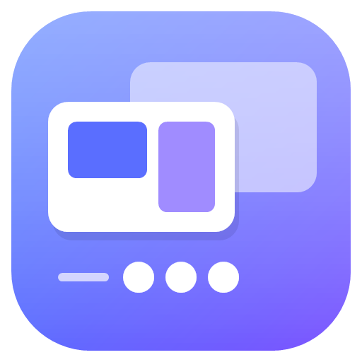
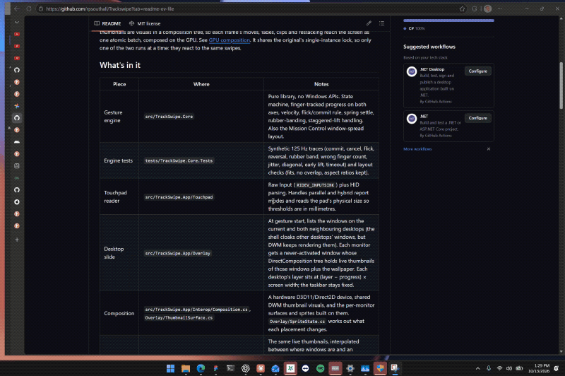
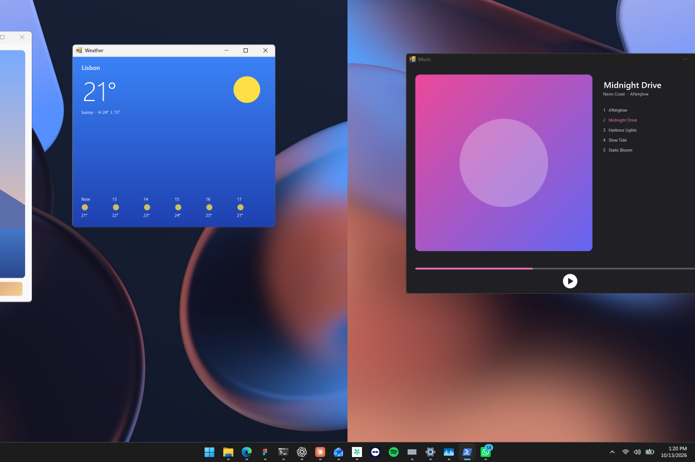

<p align="center">
  
</p>

<h1 align="center">TrackSwipe</h1>

<p align="center">
  Fluid, finger-tracked desktop switching and Mission Control for Windows 11 touchpads.<br>
  One small native app: no installer framework, no runtime, 10 to 30 MB of memory.
</p>

<p align="center">
  
</p>

Windows switches desktops with a canned animation that plays *after* you swipe. TrackSwipe makes the desktop follow your fingers instead, like a Mac: your live windows slide away under your fingers while the next desktop slides in, you can change your mind halfway, and a spring finishes the move when you let go. Swipe up and every window spreads out in a Mission Control overview.

## Features

- **Finger-tracked desktop switching.** Swipe sideways with three or four fingers. The real windows, live, move 1:1 with your fingers at your display's full refresh rate (120 Hz where supported). Reverse mid-swipe to cancel; flick to go fast. It rubber-bands at the first and last desktop.
- **Mission Control.** Swipe up to spread out every window on the desktop, minimized ones included, with live previews of all your desktops along the top.
  - Click a window to bring it forward, or swipe down with the pointer over one.
  - **Drag a window onto a desktop** in the bar to move it there. Drop it on empty space in the bar to give it a new desktop beside the current one (on whichever side you dropped it), or on **+** to add one at the end.
  - Click a desktop to switch to it, drag desktops to reorder them, add one with **+**, close one with its **×**.
  - Swipe sideways to look at the neighbouring desktops' windows.
- **Works with Windows, not around it.** The switch itself is Windows' own (instantly, with its animation suppressed), so window focus, taskbar and virtual desktop state stay exactly as Windows expects.
- **Light.** A single native executable of about 6.5 MB. About 10 MB of memory after start-up and 20 to 30 MB in use (Windows Task Manager's Memory column), and no CPU use while idle: ordinary pointer movement is filtered out the moment it arrives.

<p align="center">
  
</p>

## Install

Requires Windows 11 and a precision touchpad (any modern laptop's built-in touchpad).

1. Download the latest release from the [Releases page](https://github.com/rpsouthall/Trackswipe/releases/latest):
   - **TrackSwipe-arm64.exe** for Snapdragon / ARM laptops (for example Surface Laptop 7),
   - **TrackSwipe-x64.exe** for Intel and AMD laptops.
2. Run it. TrackSwipe sets itself up in one step and asks two things:
   - **Three or four fingers.** Windows' own swipe for that finger count is switched off so the two don't both fire. Uninstalling switches it back on.
   - **Run as administrator** (optional, see below).
3. That's it. TrackSwipe starts, sits in the notification area, and starts again when you sign in.

TrackSwipe installs for your account only, in `%LOCALAPPDATA%\Programs\TrackSwipe`, with a Start menu entry. It doesn't need administrator rights to install. You can also choose **Run without installing** to try it first.

> The download isn't code-signed yet, so Windows SmartScreen may warn about an unrecognised app. Choose **More info**, then **Run anyway**.

### Administrator mode

Windows keeps touchpad input away from normal apps while an app running as administrator is in front (Task Manager, some system tools, or apps like Wintoys). Gestures then do nothing until you click elsewhere. If you tick **Run as administrator** during setup, or choose it later from the tray menu, TrackSwipe runs elevated so gestures work everywhere. Windows asks for permission once; after that TrackSwipe starts that way at sign-in without asking (through a scheduled task). If an administrator app comes to the front while TrackSwipe isn't elevated, it tells you once and offers to switch.

## Using it

| Gesture | What happens |
|---|---|
| Three or four fingers left / right | Switch to the next or previous desktop, tracking your fingers |
| Three or four fingers up | Open Mission Control |
| Swipe down in Mission Control | Close it (onto the window under the pointer, if any) |
| Swipe sideways in Mission Control | Pan to the neighbouring desktop's windows |
| Three or four fingers down | Show the desktop |

Right-click the tray icon for:
- **Gestures enabled:** pause and resume.
- **Gesture fingers:** three or four. Windows' own swipes follow along.
- **Spring:** Snappy or Smooth.
- **Preview animation** and an **Input monitor** that shows your touches live.
- **Start at sign-in** and **Run as administrator**.
- **Taskbar** (all off unless you turn them on):
  - **Hide Start button** (the Windows key still opens Start). On a left-aligned taskbar the app buttons then start as far from the edge as the clock ends from the other.
  - **Hide the taskbar's edge line** (the hairline where it meets the desktop).
  - **Hide the open-app indicators** (the short lines under open apps' buttons; with labels shown, the label and highlight say as much).
  - **Larger tray icons and text** (the network, volume, battery and overflow icons drawn half as large again and evenly spaced, with the clock, battery percentage and app titles enlarged to match, all on one centre line and baseline, closer to a Mac's menu bar).
  - **Hide a top taskbar in Mission Control** (a taskbar moved to the top of the screen slides away as Mission Control opens, and the overview uses its space, as the menu bar does on a Mac).

  All but the last work inside Explorer: TrackSwipe loads a small helper into it only once one of them is on, changes only how those parts look, and puts the taskbar back when they're turned off or TrackSwipe quits.

## Uninstall

Settings > Apps > Installed apps > TrackSwipe > Uninstall. TrackSwipe closes, removes itself, and puts Windows' touchpad swipes back the way they were.

## How it works

TrackSwipe is a C# program compiled ahead of time to native code (.NET Native AOT). It uses no UI framework, just Win32, DirectComposition and DWM.

- **Input.** Raw precision-touchpad reports are read on their own thread, in millimetres, with the hardware's own scan timestamps. Pointer movement and two-finger scrolling are filtered out right there, so normal touchpad use never wakes the rest of the app. Steady-state input handling allocates no memory.
- **Gestures.** A small engine (`src/TrackSwipe.Core`, unit-tested on synthetic traces) turns contacts into progress and velocity, decides between commit and cancel, and settles with a spring.
- **Rendering.** Each monitor gets a transparent window whose content is a DirectComposition visual tree. Windows are shown as DWM's live shared thumbnails, composed on the GPU by DWM itself. Frames are paced by the compositor clock, and each frame's changes reach the screen as one atomic batch.
- **The switch.** When a swipe commits, TrackSwipe asks Explorer to switch desktops instantly (no animation), which lands exactly where the slide ended. It keeps its overlay up until the switch is on screen, so you never see the jump. If Explorer's interface isn't available, it falls back to the keyboard shortcut.
- **Footprint.** No .NET runtime, JIT or framework: one native executable. The garbage collector is configured for a small, compact heap, and between gestures only the touchpad reader wakes, to discard pointer movement.

## Build from source

You need the [.NET 8 SDK](https://dotnet.microsoft.com/download/dotnet/8.0) and, for the native executables, the Visual Studio C++ build tools (the "Desktop development with C++" workload).

```powershell
.\build.ps1
```

This runs the tests, builds the small C++ helper the taskbar options load into Explorer (`src/TrackSwipeTap`, embedded in each executable), and writes `dist\TrackSwipe-arm64.exe` and `dist\TrackSwipe-x64.exe`. For a quick debug run, use `dotnet run --project src/TrackSwipe` (Debug builds skip setup and include the `--diagnose*` self-tests used for development).

```
src/TrackSwipe        the app: touchpad input, overlay, Mission Control, tray, setup
src/TrackSwipe.Core   the gesture engine and layout maths (no Windows APIs)
src/TrackSwipeTap     C++ helper loaded into Explorer for the taskbar options (adapted from HideStart)
tests/                unit tests
assets/               icon and screenshots
```

## Privacy

Touch data stays in memory and is never stored. The log in `%LOCALAPPDATA%\TrackSwipe` records start-up settings, the touchpad model and errors. No network access, no telemetry.

## Limits

- TrackSwipe relies on two undocumented parts of Windows 11: DWM's shared thumbnail visuals and Explorer's virtual desktop interface. They're checked at start-up. If a Windows update changes them, TrackSwipe says so (or falls back to the keyboard shortcut for switching).
- DWM thumbnails don't include window shadows or the Mica/Acrylic backdrop, so apps that rely on it get a matching solid backing during the animation.
- The desktop bar appears on the primary monitor only.
- Full-screen games aren't detected yet.

## License

[MIT](LICENSE)
